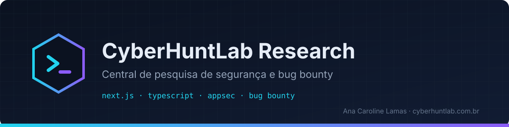

<p align="center"></p>

# CyberHuntLab Research — central de pesquisa de segurança e bug bounty

Aplicação web em **Next.js** para organizar pesquisas de segurança autorizadas: definir o escopo do programa, registrar achados com CWE, risco e evidências, e exportar um **relatório Markdown** pronto para revisão e divulgação responsável. O fluxo principal funciona inteiro no navegador, sem chave de API. Opcionalmente, um rascunho de plano ou relatório pode ser gerado com **Gemini** ou **OpenAI** pelo servidor.

Inclui também, desativado por padrão, o estúdio legado **OpenUI Code Code** (interface web para o OpenCode).

## Recursos

- **Landing page** responsiva que apresenta a plataforma e a metodologia (escopo → revisão de código → triagem → relatório).
- **Central `/security`** em quatro etapas:
  1. escopo autorizado (programa, alvo, regras);
  2. atalho para o Daybreak Defense Factory, serviço externo de revisão de código;
  3. registro manual de achados (título, CWE, severidade, evidência);
  4. geração e download do relatório em Markdown.
- **Assistência opcional com IA** (`POST /api/security`): exige `APP_ACCESS_TOKEN`, confirmação de autorização e URL HTTPS sem credenciais, parâmetros ou fragmentos. A saída é sempre um rascunho não verificado.
- **Estúdio legado protegido**: `/studio` e as demais rotas `/api/*` respondem 403 enquanto `ENABLE_PRIVATE_STUDIO` não for `true` e exigem o cabeçalho `x-app-token`.

## Instalação

Requisitos: **Node.js 20+** e npm.

```bash
git clone https://github.com/ticarollamas-arch/cyberhuntlab-gsoc-research--1-.git
cd cyberhuntlab-gsoc-research--1-
npm install
cp .env.example .env.local   # opcional, só para recursos com IA ou o estúdio
```

### Variáveis de ambiente

| Variável | Uso |
|---|---|
| `APP_ACCESS_TOKEN` | Token exigido nas rotas protegidas (`x-app-token`) |
| `ENABLE_PRIVATE_STUDIO` | `true` libera o estúdio legado; padrão `false` |
| `GEMINI_API_KEY` / `GEMINI_MODEL` | Provedor Gemini (padrão `gemini-2.5-flash`) |
| `OPENAI_API_KEY` / `OPENAI_MODEL` | Provedor OpenAI (padrão `gpt-4.1-mini`) |
| `GROQ_API_KEY`, `OPENCODE_SERVER_URL`, `OPENCODE_SERVER_PASSWORD`, `GITHUB_TOKEN`, `S3_*` | Opcionais, usados pelo estúdio |

As chaves ficam somente no servidor e nunca no navegador.

## Como usar

```bash
npm run dev      # desenvolvimento em http://localhost:3000
npm run build    # build de produção
npm start        # servidor de produção
npm run lint     # checagem de tipos (tsc --noEmit)
```

1. Abra `/` e depois `/security`.
2. Preencha o escopo com um alvo para o qual você tem **autorização explícita**.
3. Registre os achados e gere o relatório Markdown; revise antes de enviar ao programa.
4. Para o rascunho com IA, configure o `.env.local` e informe o token na interface.

A implantação no **Vercel** já está configurada (`vercel.json`, `.vercelignore`). Veja [DEPLOY-SECURITY.md](DEPLOY-SECURITY.md) e [AUDITORIA-DAYBREAK.md](AUDITORIA-DAYBREAK.md) para recomendações de segurança, limitações e roadmap.

## Estrutura

```
src/app/page.tsx            landing page
src/app/security/page.tsx   central de pesquisa
src/app/api/security/       rascunho com Gemini/OpenAI
src/app/studio/ + api/*     estúdio legado OpenUI Code Code (desativado)
src/middleware.ts           bloqueio do estúdio e autenticação por token
```

## Tecnologias

Next.js 15 · React · TypeScript · lucide-react · JSZip · Gemini API · OpenAI API · `@opencode-ai/sdk` · Vercel

## Créditos

O estúdio legado usa o [OpenCode](https://github.com/anomalyco/opencode), por meio do SDK oficial `@opencode-ai/sdk`, como motor de execução; os créditos do motor pertencem aos seus mantenedores. O plugin [opencode-dynamic-context-pruning](https://github.com/Tarquinen/opencode-dynamic-context-pruning), referenciado em `opencode.json`, é distribuído sob AGPL-3.0. Detalhes em [UPSTREAMS.md](UPSTREAMS.md).

Projeto independente, sem associação ou aprovação do Google, da OpenAI ou do Google Summer of Code.

## Licença

Código deste repositório sob a licença MIT. Veja [LICENSE](LICENSE). Dependências de terceiros mantêm suas próprias licenças.
